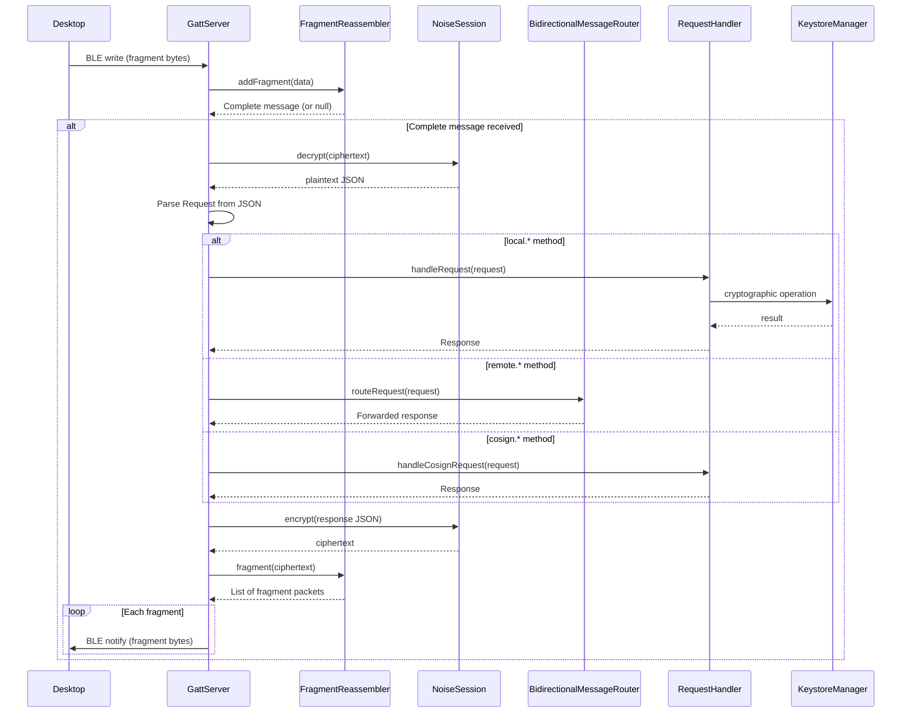

# Remote key access architecture

> **Status: REFERENCE** · Last verified: 2026-10-09
> As-built description of how xKey forwards `remote.*` requests to the desktop.

## Message Types

### Remote Methods (forwarded to desktop)

Messages prefixed with `remote.*` are forwarded through the
`BidirectionalMessageRouter` to the connected desktop client.

| Method | Description |
|--------|-------------|
| `remote.listKeys` | List keys on the desktop keychain |
| `remote.sign` | Request signing from desktop key |
| `remote.getPublicKey` | Get desktop public key |
| `remote.attestDevice` | Request device attestation from desktop |
| `remote.oathAdd` | Store a phone OATH credential on the desktop (`RemoteOathClient.oathAdd`) |
| `remote.oathGenerate` | Get the current code and expiry of a desktop-stored OATH credential (`RemoteOathClient.oathGenerate`) |

### OATH methods

`RemoteOathClient` sends both methods over the active transport
(`XKeyGattService.remoteOathClient()`, null with no desktop connected).
Shapes follow go-xkms `pkg/pairing/protocol_oath.go` at `xkey/v0.64.2-alpha`:

| Method | Params | Result |
|--------|--------|--------|
| `remote.oathAdd` | `{"credential": {name, issuer?, account_name?, secret (Base32), type ("totp"/"hotp"), algorithm?, digits?, period?, counter?}}` | `{success, credential_id, message?}` |
| `remote.oathGenerate` | `{"credential_id"}` | `{code, expires_in?}` (seconds, TOTP only) |

- Request IDs come from one counter shared by all `RemoteOathClient`
  instances, starting above 5,000,000 (key 1M, sync 2M, enrollment 3M,
  backup 4M).
- The oathAdd body is built by hand so the secret never becomes a String;
  the caller's secret chars and the sent body are zeroed after the send.
- Replies are type checked: `success` must be a boolean, `credential_id` a
  non-empty string, `code` a digit string and `expires_in` a non-negative
  integer. `success: false` or anything off-shape throws `ProtocolException`.
- The OATH screen offers "Copy to desktop" and, once a credential has a
  desktop copy, "Show desktop code". The phone keeps only the oathId to
  `credential_id` link (SharedPreferences `oath_desktop_links`). With no
  desktop connected neither entry shows and nothing is sent.

## BLE Protocol Communication Stack

