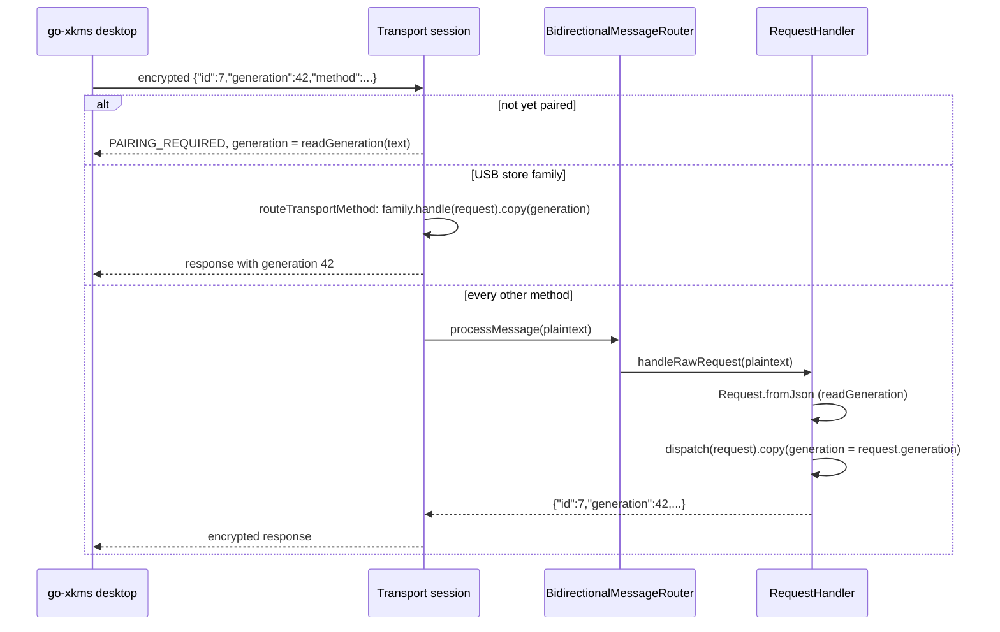

# Request generation echo architecture

> **Status: REFERENCE** · Last verified: 2026-11-12
> As-built description of how the phone copies a request's top-level `generation` into every response it sends, the phone half of the go-xkms#128 change.

## Summary

A desktop may put a top-level `generation` member, a uint64, in each JSON-RPC
request. The phone never computes with it: it copies the value verbatim into
the response so the desktop can match the answer to the request generation it
sent. A request without a `generation` gets a response without one.

The value is read from the message text by `readGeneration`, not from a parsed
`JSONObject`, because Android's org.json turns an integer literal above
`Long.MAX_VALUE` into a `Double` and rounds it. It is stored as a `ULong` and
written back as a `Long` when it fits, otherwise as a `BigInteger`, so the
digits round-trip exactly up to `18446744073709551615`.

The echo is applied in one place per path rather than by each method handler:
`RequestHandler.handleRequest` for every method the shared handler serves,
`StreamPairingSession.routeTransportMethod` for the USB-only store families,
and each refusal the transports build themselves before routing.

## Components

| Component | File | Role |
|-----------|------|------|
| `Request.generation`, `Request.fromJson` | `app/src/main/kotlin/com/automatethethings/xkey/protocol/Messages.kt` | `generation: ULong?`; `fromJson` fills it from `readGeneration(json)` |
| `Response.generation`, `Response.success` / `Response.error` | same file | Optional `generation` argument; `toJsonString` writes it only when non-null |
| `readGeneration`, `GENERATION_KEY` | same file | Walks the top-level members with a `JSONTokener` and returns the `generation` literal if it matches `0` or `[1-9][0-9]*` and fits a `ULong`; otherwise null |
| `RequestHandler.handleRequest` / `handleRawRequest` | `app/src/main/kotlin/com/automatethethings/xkey/protocol/Handler.kt` | `dispatch(request).copy(generation = request.generation)`; a request that fails to parse still gets `readGeneration(json)` on its error |
| `BidirectionalMessageRouter` | `app/src/main/kotlin/com/automatethethings/xkey/remote/BidirectionalMessageRouter.kt` | Passes inbound requests to `RequestHandler.handleRawRequest` |
| `StreamPairingSession.routeTransportMethod`, `rejectUnpaired`, `handlePairingConfirm`, `confirmAlreadyPaired` | `app/src/main/kotlin/com/automatethethings/xkey/transport/StreamPairingSession.kt` | USB/TCP: echo on the store families, on `PAIRING_REQUIRED`, and on `pairing.confirm` answers |
| `GattServer.rejectUnpaired`, `handlePairingConfirmIfNeeded` | `app/src/main/kotlin/com/automatethethings/xkey/ble/GattServer.kt` | BLE GATT: the same refusals and `pairing.confirm` answers |
| `BleClient.dispatchInboundRequest` | `app/src/main/kotlin/com/automatethethings/xkey/ble/BleClient.kt` | Phone-initiated sessions: echo on its own refusals |
| `FrameBudget.GENERATION_RESERVE` | `app/src/main/kotlin/com/automatethethings/xkey/usb/FrameBudget.kt` | Reserves `,"generation":18446744073709551615` in `RESULT_BUDGET` so a USB store result still fits one frame |

## Wire methods and Android entry points

- No method of its own. The member applies to every JSON-RPC request on every
  transport: BLE GATT, TCP, USB and phone-initiated BLE sessions.
- Request: `{"id":7,"generation":42,"method":"...","params":{...}}`.
  Response: `{"id":7,"generation":42,"result":{...}}` or with `error`.
- Only the top-level member counts; a `generation` inside `params` is not the
  request's.
- No code that sets `generation` on the phone's own outbound `remote.*`
  requests was found in `app/src/main/kotlin/com/automatethethings/xkey/remote/`.

## Main flow

## Errors and refusals

- A request that does not parse: the error has `id` 0 and still carries the
  generation if it can be read. A message malformed only after the
  `generation` member keeps it; one malformed before it, or text that is not
  JSON, gets an error without one.
- A `generation` that is negative, has a sign, a leading zero, a fraction, an
  exponent, or is above the uint64 range is treated as absent.
- Refusals echo it too: `PAIRING_REQUIRED` (-32025), `PAIRING_REJECTED`
  (-32017), `METHOD_NOT_FOUND` (-32601) and `INTERNAL_ERROR` (-32603) from
  `BleClient`, and every handler error.
- `RequestHandler.createErrorResponse(id, code, message)` takes no generation
  and builds a response without one.
- The KDoc on `FrameBudget.GENERATION_RESERVE` says "[Response] has no
  generation here yet"; `Response` does carry one on main, so that comment is
  out of date. The reserve itself is applied to every response either way.

## Tests

- JVM: `GenerationEchoTest`
  (`app/src/test/kotlin/com/automatethethings/xkey/protocol/`): success and
  error paths, `0`, `Long.MAX_VALUE` and the largest uint64, a generation after
  `params`, inside `params`, a missing id, truncated and malformed text, and
  `readGeneration` itself. `FrameBudgetTest`
  (`app/src/test/kotlin/com/automatethethings/xkey/usb/`): the reserve and the
  frame budget with the widest generation.

## Related features

- [usb-transport](../usb-transport/architecture.md) and [tcp-pairing](../tcp-pairing/architecture.md): the stream sessions and USB store families that echo it.
- [phone-initiated-pairing](../phone-initiated-pairing/architecture.md): `BleClient` refusals.
- [device-attestation](../device-attestation/architecture.md): `local.attestDevice` answers carry it like any method.
