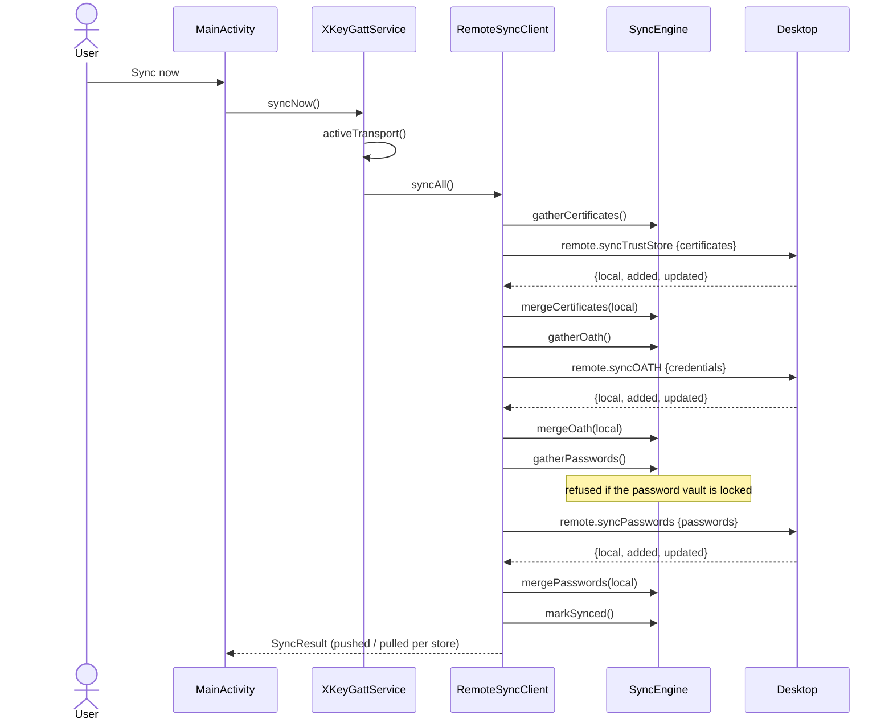

# Store sync architecture

> **Status: REFERENCE** · Last verified: 2026-11-12
> As-built description of how xKey synchronizes its trust store, OATH credentials and passwords with a paired desktop.

## Summary

One class, `SyncEngine`, gathers (exports) and merges (imports) the three
synced stores: the trust store, OATH credentials and passwords. Both
directions use it:

- **Inbound** (`local.sync*`, desktop to phone): `RequestHandler` merges the
  desktop's items, then returns the phone's items in a `remote` array.
- **Outbound** (`remote.sync*`, phone to desktop): `RemoteSyncClient` sends the
  phone's items, then merges the desktop's reply, which comes back in a `local`
  array.

The DTO field names follow the go-xkms pairing contract
(`pkg/pairing/protocol_sync.go`: `SyncCertificate`, `SyncOATHCredential`,
`SyncPassword`).

## Components

| Class | File | Role |
|-------|------|------|
| `SyncEngine` | `app/src/main/kotlin/com/automatethethings/xkey/sync/SyncEngine.kt` | Gather and merge for each store (`gatherCertificates`, `mergeCertificates`, `gatherOath`, `mergeOath`, `gatherPasswords`, `mergePasswords`), plus status (`deviceId`, `storeChecksums`, `lastSyncRfc3339`, `markSynced`) |
| `PasswordSync` | `app/src/main/kotlin/com/automatethethings/xkey/sync/PasswordSync.kt` | Password gather and merge, behind the password vault's lock (see [password-vault](../password-vault/architecture.md)) |
| `RemoteSyncClient` | `app/src/main/kotlin/com/automatethethings/xkey/remote/RemoteSyncClient.kt` | Phone-initiated sync: `syncAll`, `syncTrustStore`, `syncOath`, `syncPasswords` |
| `RequestHandler` | `app/src/main/kotlin/com/automatethethings/xkey/protocol/Handler.kt` | Inbound handlers `handleSyncTrustStore`, `handleSyncOATH`, `handleSyncPasswords`, `handleSyncStatus` |
| `XKeyGattService` | `app/src/main/kotlin/com/automatethethings/xkey/ble/XKeyGattService.kt` | `syncNow()` picks the active transport (`activeTransport()`: BLE, then TCP, then USB) and runs `RemoteSyncClient.syncAll()` |
| `MainActivity` | `app/src/main/kotlin/com/automatethethings/xkey/ui/MainActivity.kt` | Calls `syncNow()` from the UI |
| `SyncCodec` | `app/src/main/kotlin/com/automatethethings/xkey/crypto/SyncCodec.kt` | PEM/DER conversion, RFC 3339 times, store checksums |
| `SyncStateRepository` | `app/src/main/kotlin/com/automatethethings/xkey/settings/SyncStateRepository.kt` | Stores the last successful sync time |
| `TrustStoreRepository` | `app/src/main/kotlin/com/automatethethings/xkey/truststore/TrustStoreRepository.kt` | The trust store read and written by the certificate leg |
| `OathRepository`, `OathSecretManager` | `app/src/main/kotlin/com/automatethethings/xkey/oath/` | The OATH store; secrets are decrypted for export and re-imported through an `otpauth://` URI |

## Wire methods

Method names are constants in `MethodNames` (`protocol/Messages.kt`).

| Method | Direction | Params | Result |
|--------|-----------|--------|--------|
| `local.syncTrustStore` | desktop to phone | `certificates` | `added`, `skipped`, `remote` |
| `local.syncOATH` | desktop to phone | `credentials` | `added`, `updated`, `skipped`, `remote` |
| `local.syncPasswords` | desktop to phone | `passwords` | `added`, `updated`, `skipped`, `remote` |
| `local.syncStatus` | desktop to phone | none | `last_sync`, `device_id`, `store_checksums` (`oath`, `passwords`, `trust_store`) |
| `remote.syncTrustStore` | phone to desktop | `certificates` | `local`, `added`, `updated` |
| `remote.syncOATH` | phone to desktop | `credentials` | `local`, `added`, `updated` |
| `remote.syncPasswords` | phone to desktop | `passwords` | `local`, `added`, `updated` |

`MethodNames` also defines `REMOTE_SYNC_ALL` (`remote.syncAll`) and
`REMOTE_SYNC_STATUS` (`remote.syncStatus`); no code on main sends them.
`RemoteSyncClient.syncAll()` runs the three `remote.sync*` legs in turn.

## Merge rules

- **Certificates:** skipped when the fingerprint is already in the trust store
  or the PEM does not decode; otherwise imported with the `purpose` field as its
  label (`sync` when blank).
- **OATH:** an entry without an id (or name), secret or `account_name` is
  skipped; the rest are imported through `OathRepository.importFromUri`, counted
  as updated when the id already existed.
- **Passwords:** `PasswordSync.merge` patches an existing entry in place or adds
  a new personal, non-expiring entry in the default tenant. `PasswordSync.gather`
  leaves out entries with a non-default tenant, sharing or an expiry, because
  `SyncPassword` cannot carry them.
- **Status:** `storeChecksums` hashes OATH ids with counters, password ids with
  update times (read without decrypting a password) and trust-store
  fingerprints. It is not behind the password vault's lock.

## Main flow

The inbound flow is the mirror image: `RequestHandler` builds a `SyncEngine`,
calls the store's merge, then its gather, then `markSynced()`, and answers with
the counts and the `remote` array.

## Errors and refusals

- `syncNow()` throws `IllegalStateException` when no desktop is connected.
- `RemoteSyncClient` throws `ProtocolException` when the desktop returns an
  error, or with `ErrorCodes.INTERNAL_ERROR` when no reply arrives within
  `requestTimeoutMs` (30 s by default).
- A locked password vault throws `PasswordStoreLockedException` before anything
  is read or written. `syncAll()` catches it, logs it and still syncs the other
  stores. `handleSyncPasswords` answers `ErrorCodes.PASSWORD_STORE_LOCKED`
  (-32040).
- Any other failure in an inbound sync handler answers
  `ErrorCodes.INTERNAL_ERROR` with the method name in the message.
- `markSynced()` logs and ignores a failure to record the sync time.

## Tests

| Test class | Covers |
|------------|--------|
| `RemoteSyncClientTest` (`app/src/test/.../remote/`) | Outbound legs and push counts |
| `RemoteClientInteropTest` (`app/src/test/.../remote/`) | Outbound client wire interop |
| `SyncEngineStatusTest`, `SyncEngineTrustStoreTest`, `PasswordSyncTest` (`app/src/test/.../sync/`) | Status checksums, certificate merge, password gather and merge |
| `SyncCodecTest` (`app/src/test/.../crypto/`) | Codec helpers |
| `SyncEngineTest` (`app/src/androidTest/.../sync/`) | Engine on a device database |
| `SyncStateRepositoryTest` (`app/src/androidTest/.../settings/`) | Last-sync time |
| `BleSyncLoopbackTest` (`app/src/androidTest/.../ble/`) | `local.sync*` over the BLE loopback |
| `ProtocolIntegrationTest` (`app/src/androidTest/.../e2e/`) | `local.sync*` end to end |
| `RequestHandlerErrorPathTest` (`app/src/androidTest/.../protocol/`) | Sync handler error paths |

## Related features

- [password-vault](../password-vault/architecture.md): the lock that guards the password leg
- [trust-store-bootstrap](../trust-store-bootstrap/architecture.md): the trust store the certificate leg syncs
- [desktop-backup-store](../desktop-backup-store/architecture.md): backups over the same paired transports
- [noise-pairing](../noise-pairing/architecture.md): the paired session sync runs on
