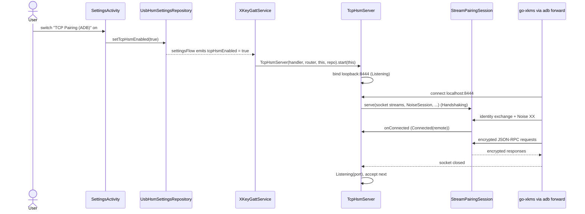

# TCP pairing architecture

> **Status: REFERENCE** · Last verified: 2026-11-23
> The loopback TCP pairing server on `:8444`, which the emulator and ADB end-to-end suites use.

## Summary

`TcpHsmServer` listens on the loopback address, port `8444`
(`TcpHsmServer.DEFAULT_PORT`, matching go-xkms `DefaultTCPAddress =
"localhost:8444"`). A desktop reaches it through `adb forward tcp:8444
tcp:8444` or from an emulator host. Binding to loopback keeps the port off the
LAN. Each accepted socket is served by the same `StreamPairingSession`
responder as USB, with the same `StreamMessageFraming` (2-byte big-endian
length, one Noise message per frame). The identity exchange, Noise XX
handshake, `pairing.confirm` gate and JSON-RPC loop are therefore the same
bytes as on the [USB transport](../usb-transport/architecture.md). The server
runs only while the TCP Pairing (ADB) switch in Settings is on. It is off by
default.

## Components

Paths are relative to `app/src/main/kotlin/com/automatethethings/xkey/`.

| Component | File | Role |
|-----------|------|------|
| `TcpHsmServer` | `tcp/TcpHsmServer.kt` | `start` binds a `ServerSocket` to `InetAddress.getLoopbackAddress()`; `acceptLoop` serves one socket at a time; `handleConnection` loads the Noise static key and runs `StreamPairingSession.serve` with `transportLabel = "TCP"` and a connection id `tcp:<uuid>`; `stop` closes the listener and the active socket; `connectedDesktop` returns the desktop for outbound `remote.*` requests while the state is `Connected`, with a sender bound to that connection; `confirmedPeerKeyHex` returns the peer this connection confirmed |
| `TcpHsmState` | same file | `Stopped`, `Listening(port)`, `Handshaking`, `Connected(remote)`, `Error(message)` |
| `StreamPairingSession` | `transport/StreamPairingSession.kt` | Shared responder (see [usb-transport](../usb-transport/architecture.md)) |
| `StreamMessageFraming` | `transport/StreamMessageFraming.kt` | Shared framing |
| `XKeyGattService.startTcpHsmServer` / `stopTcpHsmServer` | `ble/XKeyGattService.kt` | Collects `UsbHsmSettingsRepository.settingsFlow` and starts or stops the server on `tcpHsmEnabled`; builds a `BidirectionalMessageRouter` for TCP; feeds the server's state to the desktop session tracker |
| `UsbHsmSettingsRepository.setTcpHsmEnabled` | `usb/UsbHsmSettings.kt` | Persists `tcp_hsm_enabled` (default `false`). Each change is audited as a `SETTINGS_CHANGED` entry with setting `tcpPairing` and its old and new values. `AuditLogger.editAuditedSetting` writes the entry with the change, so a committed write is audited even when its caller is cancelled |
| `SettingsActivity` | `ui/SettingsActivity.kt` | The switch titled by `settings_usb_tcp_title` ("TCP Pairing (ADB)") |

## Wire methods and Android entry points

- Entry point: the setting. The flow collector receives the stored value at
  once, so the server comes up at service start when the switch is on. No
  intent or manifest entry is involved.
- The wire is the one the USB page lists: identity exchange, Noise XX,
  `pairing.confirm`, then every method the shared `RequestHandler` serves
  through `BidirectionalMessageRouter.processMessage`. `TcpHsmServer` builds
  its session without `transportMethods`, so the USB-only `Password*` and
  `SealStore*` families are not served over TCP.

## Main flow

## Errors and refusals

- `start` while already started logs a warning and returns.
- A bind or accept-loop failure sets `TcpHsmState.Error` and then `Stopped`.
- One connection at a time: the accept loop does not call `accept` again until
  the current connection ends.
- The handshake deadline, the pairing gate (`PAIRING_REQUIRED`,
  `PAIRING_REJECTED`), oversize frames and revocation on unpair behave as on
  USB, since all of it lives in `StreamPairingSession`.

## Tests

- JVM, in `app/src/test/kotlin/com/automatethethings/xkey/tcp/`:
  `TcpHsmServerDefaultPortTest`, `TcpHsmServerHandshakeTimeoutTest`,
  `TcpHsmServerRevocationTest` and `TcpConnectedDesktopBindingTest`, with
  helpers in `TcpHsmServerTestSupport.kt`. The shared session tests are in
  `app/src/test/kotlin/com/automatethethings/xkey/transport/`.
- Instrumented: `TcpHsmServerTest` and the helper `EnableTcpPairingHelper`
  (`app/src/androidTest/kotlin/com/automatethethings/xkey/tcp/`);
  `ProtocolIntegrationTest`, `PairingSecurityTest` with `ProtocolTestClient`,
  and `TcpHsmSettingEnabler`
  (`app/src/androidTest/kotlin/com/automatethethings/xkey/e2e/`).
- `make e2e-setup` installs the app and its test APK, runs
  `TcpHsmSettingEnabler` to turn the setting on, and runs
  `adb forward tcp:8444 tcp:8444` for the go-xkms probe.

## Related features

- [usb-transport](../usb-transport/architecture.md): the same session over USB.
- [device-attestation](../device-attestation/architecture.md): `local.attestDevice` over this transport.
- [request-generation-echo](../request-generation-echo/architecture.md): `generation` in every response.
