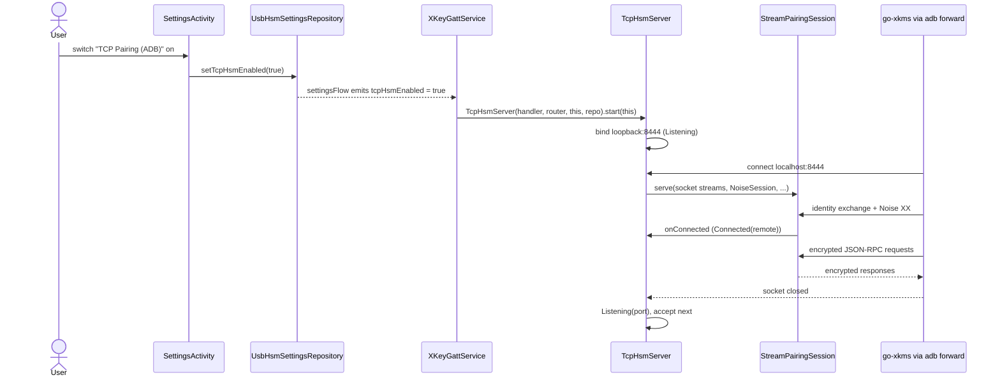

# TCP pairing architecture

> **Status: REFERENCE** · Last verified: 2026-11-12
> As-built description of the loopback TCP pairing server on `:8444`, the transport the emulator and ADB end-to-end suites use.

## Summary

`TcpHsmServer` listens on the loopback address, port `8444`
(`TcpHsmServer.DEFAULT_PORT`, matching go-xkms `DefaultTCPAddress =
"localhost:8444"`). A desktop reaches it through `adb forward tcp:8444
tcp:8444` or from an emulator host. Each accepted socket is served by the same
`StreamPairingSession` responder as USB, with the same `StreamMessageFraming`
(2-byte big-endian length, one Noise message per frame), so the identity
exchange, Noise XX handshake, `pairing.confirm` gate and JSON-RPC loop are
byte-identical to the [USB transport](../usb-transport/architecture.md). The
server runs only while the Settings toggle **TCP Pairing (ADB)** is on.

## Components

| Component | File | Role |
|-----------|------|------|
| `TcpHsmServer` | `app/src/main/kotlin/com/automatethethings/xkey/tcp/TcpHsmServer.kt` | `start` binds a `ServerSocket` to `InetAddress.getLoopbackAddress()`, `acceptLoop` serves one socket at a time, `handleConnection` runs `StreamPairingSession.serve` with `transportLabel = "TCP"`; `stop` closes the listener and the active socket; implements `MessageSender` |
| `TcpHsmState` | same file | `Stopped`, `Listening(port)`, `Handshaking`, `Connected(remote)`, `Error(message)` |
| `StreamPairingSession` | `app/src/main/kotlin/com/automatethethings/xkey/transport/StreamPairingSession.kt` | Shared responder (see [usb-transport](../usb-transport/architecture.md)) |
| `StreamMessageFraming` | `app/src/main/kotlin/com/automatethethings/xkey/transport/StreamMessageFraming.kt` | Shared framing |
| `XKeyGattService.startTcpHsmServer` / `stopTcpHsmServer` | `app/src/main/kotlin/com/automatethethings/xkey/ble/XKeyGattService.kt` | Collects `UsbHsmSettingsRepository.settingsFlow` and starts or stops the server on `tcpHsmEnabled`; builds a `BidirectionalMessageRouter` for TCP; `activeTransport` picks TCP for outbound `remote.*` when its state is `Connected` |
| `UsbHsmSettingsRepository.setTcpHsmEnabled` | `app/src/main/kotlin/com/automatethethings/xkey/usb/UsbHsmSettings.kt` | Persists `tcp_hsm_enabled` (default `false`) |
| `SettingsActivity` | `app/src/main/kotlin/com/automatethethings/xkey/ui/SettingsActivity.kt` | The switch titled by `settings_usb_tcp_title` ("TCP Pairing (ADB)") |

## Wire methods and Android entry points

- Entry point: the setting, applied at service start because the flow collector
  receives the persisted value at once. No intent or manifest entry is involved.
- The wire is the one the USB page lists: identity exchange, Noise XX,
  `pairing.confirm`, then every method the shared `RequestHandler` serves
  through `BidirectionalMessageRouter.processMessage`. The TCP server is built
  without `transportMethods`, so the USB-only `Password*` and `SealStore*`
  families are not served over TCP.

## Main flow

## Errors and refusals

- `start` while already started logs and returns.
- A bind or accept-loop failure sets `TcpHsmState.Error` and then `Stopped`.
- One connection at a time: the accept loop does not call `accept` again until
  the current connection ends.
- Handshake deadline, pairing gate (`PAIRING_REQUIRED`, `PAIRING_REJECTED`),
  oversize frames and revocation on unpair behave as on USB, since all of it
  lives in `StreamPairingSession`.

## Tests

- JVM: `TcpHsmServerDefaultPortTest`, `TcpHsmServerHandshakeTimeoutTest`,
  `TcpHsmServerRevocationTest`, with helpers in `TcpHsmServerTestSupport.kt`
  (`app/src/test/kotlin/com/automatethethings/xkey/tcp/`); the shared session
  tests in `app/src/test/kotlin/com/automatethethings/xkey/transport/`.
- Instrumented: `TcpHsmServerTest` and the helper `EnableTcpPairingHelper`
  (`app/src/androidTest/kotlin/com/automatethethings/xkey/tcp/`);
  `ProtocolIntegrationTest`, `PairingSecurityTest` with `ProtocolTestClient`,
  and `TcpHsmSettingEnabler`
  (`app/src/androidTest/kotlin/com/automatethethings/xkey/e2e/`).
- `make e2e-setup` installs the app, runs `TcpHsmSettingEnabler` to turn the
  setting on, and runs `adb forward tcp:8444 tcp:8444` for the go-xkms probe.

## Related features

- [usb-transport](../usb-transport/architecture.md): the same session over USB.
- [device-attestation](../device-attestation/architecture.md): `local.attestDevice` over this transport.
- [request-generation-echo](../request-generation-echo/architecture.md): `generation` in every response.
