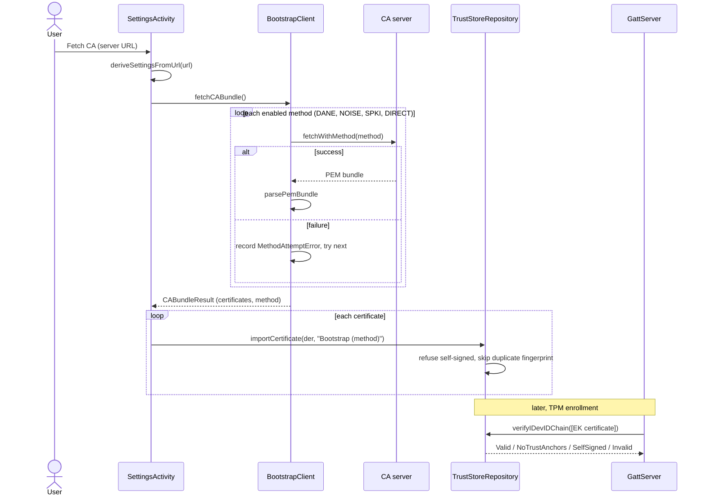

# Trust store and bootstrap architecture

> **Status: REFERENCE** · Last verified: 2026-11-12
> As-built description of how xKey fetches CA certificates from a server, keeps them in its trust store, and checks device certificate chains against them.

## Summary

The trust store is the set of CA certificates the phone trusts. It lives in
`TrustStoreRepository`, which keeps each certificate as a file in the app's
private `trust_store` directory, with metadata. Self-signed certificates are
never accepted, and a certificate already present (same fingerprint) is
skipped.

Certificates reach the store in four ways:

- **Bootstrap** (`BootstrapClient`): fetch the CA bundle from a server at
  `/v1/ca/bootstrap`, trusting the connection by DANE, Noise_NK, an SPKI pin or
  the system trust store.
- **URL import** (`CABundleFetcher`): fetch `/acme/ca-bundle` from a given base
  URL and import each certificate.
- **Manual or built-in import**: `importCertificate` from the trusted-CA screen,
  and `importInternalCACertificate` for the xKey root and intermediate CAs.
- **Sync** with the desktop (see [store-sync](../store-sync/architecture.md)).

The store is then used to check chains: `verifyIDevIDChain` runs PKIX
validation (revocation checking off) against the stored CAs. TPM enrollment in
`GattServer` uses it on the endorsement key (EK) certificate.

## Components

| Class | File | Role |
|-------|------|------|
| `BootstrapClient` | `app/src/main/kotlin/com/automatethethings/xkey/bootstrap/BootstrapClient.kt` | `fetchCABundle` (every enabled method in turn), `fetchWithMethod` (one method); `parsePemBundle`; `BOOTSTRAP_PATH`, `MAX_RESPONSE_SIZE` (1 MB), `MAX_BUNDLE_CERTIFICATES` (64) |
| `CABundleResult` | `app/src/main/kotlin/com/automatethethings/xkey/bootstrap/CABundleResult.kt` | Bootstrap result: the certificates (DER) and the method that succeeded |
| `DnsTlsaResolver`, `TlsaRecord`, `DaneVerifier`, `DaneTlsaException` | `app/src/main/kotlin/com/automatethethings/xkey/bootstrap/DaneTlsa.kt` | TLSA lookup over UDP (TCP on truncation) or DNS-over-TLS, with the DNSSEC AD flag required when configured; DANE-EE and DANE-TA chain checks |
| `BootstrapException` and subclasses | `app/src/main/kotlin/com/automatethethings/xkey/bootstrap/BootstrapExceptions.kt` | Typed bootstrap failures |
| `BootstrapMethod`, `BootstrapSettingsData` | `app/src/main/kotlin/com/automatethethings/xkey/settings/BootstrapSettings.kt` | Methods `DANE`, `NOISE`, `SPKI`, `DIRECT`; per-method config (`daneConfig`, `noiseConfig`, `spkiConfig`, `directConfig`), `timeoutSeconds`, `getEnabledMethods()` |
| `CABundleFetcher`, `CABundleFetchException` | `app/src/main/kotlin/com/automatethethings/xkey/truststore/CABundleFetcher.kt` | `fetchBundle(baseUrl)`: GET `/acme/ca-bundle` (30 s timeout); a content type other than `application/pem-certificate-chain` is only logged. Declares its own `CABundleResult` |
| `TrustStoreRepository`, `TrustedCA`, `VerificationResult`, `ImportResult` | `app/src/main/kotlin/com/automatethethings/xkey/truststore/TrustStoreRepository.kt` | Store: `importCertificate`, `importFromURL`, `importInternalCACertificate`, `getAllCertificates`, `getCertificateDER`, `hasCertificate`, `deleteCertificate`, `clearAll`, `getExpiringCertificates`, `getExpiredCertificates`, `refreshSystemInstallStatus`, `updateSystemInstalled`, `verifyIDevIDChain` |
| `SettingsActivity` | `app/src/main/kotlin/com/automatethethings/xkey/ui/SettingsActivity.kt` | "Fetch CA" button: derives bootstrap settings from the server URL, runs `fetchCABundle`, imports the result |
| `TrustStoreActivity` | `app/src/main/kotlin/com/automatethethings/xkey/ui/TrustStoreActivity.kt` | Trusted-CA screen: bootstrap with one chosen method, URL import, manual import, built-in xKey CAs |
| `GattServer` | `app/src/main/kotlin/com/automatethethings/xkey/ble/GattServer.kt` | TPM enrollment: checks the EK certificate with `verifyIDevIDChain` |

## Android entry points

There is no wire method that fetches or imports a CA bundle; the inbound and
outbound `sync*TrustStore` methods are described in
[store-sync](../store-sync/architecture.md).

- `SettingsActivity`, "Fetch CA": `deriveSettingsFromUrl(url)`, then
  `BootstrapClient(settings).fetchCABundle()`, then `importCertificate` for each
  certificate with the label `Bootstrap (<method displayName>)`. It also saves
  the URL as the XKMS endpoint (`updateXkmsEndpoint`).
- `TrustStoreActivity`: `fetchWithMethod(selectedMethod)`; `importFromURL(url,
  label)`; `importCertificate` for a picked certificate;
  `importInternalCACertificate` for "xKey Root CA" and "xKey Intermediate CA".

## Bootstrap methods

`fetchCABundle` tries the enabled methods in this order and returns the first
success: DANE, NOISE, SPKI, DIRECT. Each run is bounded by `timeoutSeconds`.

| Method | How the server is trusted | Transport |
|--------|---------------------------|-----------|
| `DANE` | TLSA records for `_<port>._tcp.<host>`. DANE-EE (usage 3) matches the leaf with no name check; DANE-TA (usage 2) needs the anchor in the chain, PKIX validation and a hostname match | HTTPS GET `<serverUrl>/v1/ca/bootstrap` |
| `NOISE` | Noise_NK against the configured server static key (`NoiseNKSession`) | TCP, 2-byte length-framed messages; sends `{"method":"get_ca_bundle"}` encrypted and reads `bundle_pem` or a base64 `certificates` array |
| `SPKI` | The leaf's SPKI SHA-256 must equal `spkiPinSha256` (64 hex characters) | HTTPS GET `<serverUrl>/v1/ca/bootstrap` |
| `DIRECT` | The system trust store | HTTPS GET `<serverUrl>/v1/ca/bootstrap` |

Response bodies are read up to `MAX_RESPONSE_SIZE`. `parsePemBundle` refuses a
bundle with more than `MAX_BUNDLE_CERTIFICATES` certificates and skips blocks
that do not decode; the Noise `certificates` array has the same limit.

## Main flow

## Errors and refusals

Bootstrap (`BootstrapException` subclasses):

| Exception | Meaning |
|-----------|---------|
| `NoMethodsConfiguredException` | No bootstrap method is enabled |
| `BootstrapFailedException` | Every enabled method failed; carries one `MethodAttemptError` per method, which `SettingsActivity` shows |
| `DANEException` | DANE not configured, a bad URL, a failed TLSA lookup or a chain that does not match |
| `NoiseBootstrapException` | Noise not configured, handshake or framing failure, or a bad reply |
| `SPKIException` | The pin does not match, or the SPKI fetch failed |
| `BootstrapConfigException` | A malformed setting, such as an SPKI pin that is not 64 hex characters |
| `DirectException` | The HTTPS fetch failed |
| `CertificateParseException` | Too many certificates in the bundle |

URL import: `CABundleFetchException` for a network error, a non-success HTTP
status, an empty body, or a body with no valid certificate.

Trust store:

- `importCertificate` throws `IllegalArgumentException` for a self-signed
  certificate and returns `null` for one already stored.
- `importFromURL` returns an `ImportResult` (`imported`, `skipped`, `errors`);
  a self-signed certificate is skipped with an error entry.
- `verifyIDevIDChain` returns `VerificationResult`: `Valid(trustLevel)`,
  `Invalid`, `SelfSigned` or `NoTrustAnchors`.

In TPM enrollment, `GattServer` logs `Valid`, accepts `NoTrustAnchors` with a
warning, and refuses `SelfSigned` and `Invalid` with
`EnrollmentRefusal.UntrustedEndorsement`. Without a trust store, the EK
certificate is not checked.

## Tests

| Test class | Covers |
|------------|--------|
| `BootstrapClientTest`, `BootstrapResultTest` (`app/src/test/.../bootstrap/`) | Method order, failures, bundle parsing and limits |
| `BootstrapDaneFetchTest`, `DaneVerifierTest`, `DaneChainVerificationTest`, `DnsTlsaResolverTest` (`app/src/test/.../bootstrap/`) | DANE fetch, TLSA lookup, DANE-EE and DANE-TA checks |
| `BootstrapNoiseTest` (`app/src/test/.../bootstrap/`) | Noise_NK bootstrap against a test responder |
| `BootstrapSettingsDataTest` (`app/src/test/.../settings/`) | Enabled methods and settings |
| `CABundleFetcherTest` (`app/src/test/.../truststore/`) | `/acme/ca-bundle` fetch |
| `TrustStoreRepositoryTest`, `TrustStorePersistenceTest` (`app/src/test/.../truststore/`) | Import, refusals, persistence, chain checks |
| `SyncEngineTrustStoreTest` (`app/src/test/.../sync/`) | Certificate merge through the store |
| `BootstrapSettingsRepositoryTest` (`app/src/androidTest/.../settings/`) | Stored bootstrap settings |
| `TrustStoreSystemInstallTest` (`app/src/androidTest/.../truststore/`) | System-install status |
| `SettingsBootstrapFlowTest`, `SettingsTrustAndConnectivityFlowTest` (`app/src/androidTest/.../ui/`) | Fetch CA from settings |
| `TrustStoreActivityUiTest`, `TrustStoreBranchTest`, `TrustStoreFlowTest`, `TrustStoreImportOutcomeTest` (`app/src/androidTest/.../ui/`) | Trusted-CA screen |

## Related features

- [store-sync](../store-sync/architecture.md): syncing the trust store with the desktop
- [certificate-authority](../certificate-authority/architecture.md): the CA side of the certificates fetched here
- [noise-pairing](../noise-pairing/architecture.md): the Noise protocol also used by the `NOISE` method
