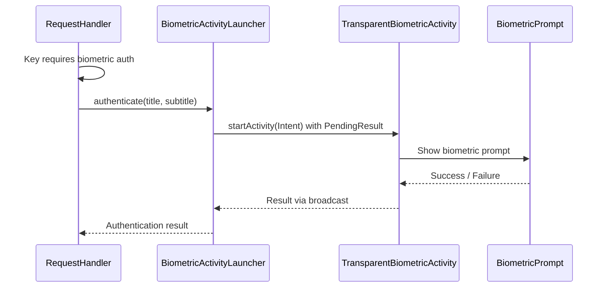

# User verification architecture

> **Status: REFERENCE** · Last verified: 2026-10-09
> As-built description of how the BLE service raises the biometric prompt in xKey.

## Inter-Process Communication

### XKeyGattService to TransparentBiometricActivity

When the BLE service needs biometric authentication and no activity is in the
foreground, it uses `BiometricActivityLauncher` to start a transparent overlay
activity:

