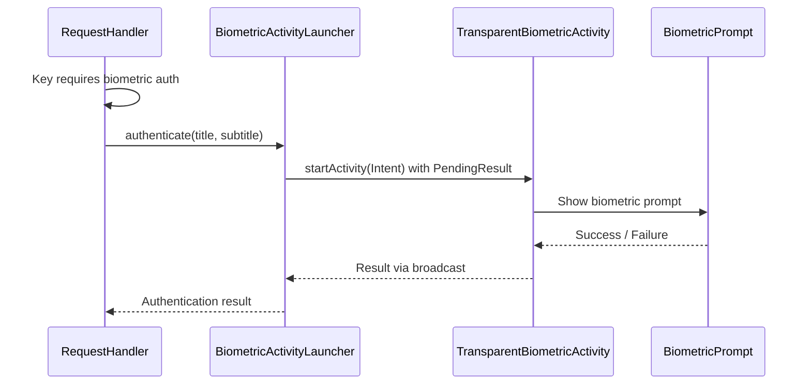

# User verification architecture

> **Status: REFERENCE** · Last verified: 2026-11-13
> As-built description of how the BLE service raises the biometric prompt in xKey.

## Inter-Process Communication

### XKeyGattService to TransparentBiometricActivity

When the BLE service needs biometric authentication and no activity is in the
foreground, it uses `BiometricActivityLauncher` to start a transparent overlay
activity:

## The time window and its clock

In the `TIME_WINDOW` auth mode, `SessionAuthManager` skips the prompt until
the window chosen in Settings (`timeWindowSeconds`) has passed since the last
successful authentication. It measures the window on
`SystemClock.elapsedRealtime()`: milliseconds since boot, monotonic, and not
moved when the user or the network sets the wall clock. The window is
half-open: the prompt returns once `timeWindowSeconds` have passed. Before the
first authentication, and after `invalidateAuth`, there is no recorded reading
and the prompt is owed, even just after boot. A reading below the recorded one
counts as expired. The window is in memory only; `clearSession` (a BLE
disconnect) keeps it.
