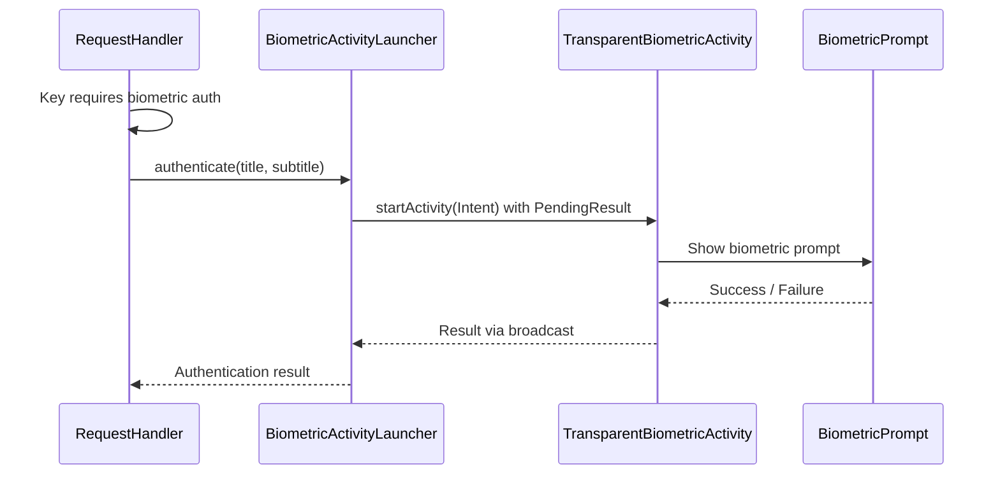

# User verification architecture

> **Status: REFERENCE** · Last verified: 2026-10-09
> As-built description of how the BLE service raises the biometric prompt in xKey.

## Inter-Process Communication

### XKeyGattService to TransparentBiometricActivity

When the BLE service needs biometric authentication and no activity is in the
foreground, it uses `BiometricActivityLauncher` to start a transparent overlay
activity:

### The one prompt queue

There is one screen, so `PromptOwnership.process` holds one queue entry per
approval and lets one be ACTIVE at a time; the rest wait QUEUED in arrival
order. Every prompt in the app is raised from an ACTIVE entry, and
`PromptEntryPointsTest` fails on any raiser that is not listed below.

| Entry point | Queue key | How it waits for its turn |
|---|---|---|
| `BiometricActivityLauncher` (generic, crypto) | `approval-<id>`, `signature-<id>` | starts its activity from the entry's `onActive` |
| `TransparentBiometricActivity` | the intent's id | shows a prompt only while `accept` finds that key ACTIVE |
| `CryptoSigningActivity` | `signature-<id>` | `CryptoSigningController.attach` prompts only for the ACTIVE entry |
| `BiometricHelper.authenticate*` | `wake-biometric-<n>` | runs inside `PromptOwnership.turn`; `onTurn` posts the wake notification |
| `local.verifyUser` injected prompt | `wake-verifyUser-<n>` | runs inside `PromptOwnership.turn` with its wake notification |
| `CredentialSelectorActivity` | `wake-credentialSelector-<n>` | `enqueue`s and prompts from `onActive`; ends the entry on answer or destroy |
| `BiometricNotificationHelper.showBiometricRequiredNotification` | the caller's key | refuses (throws) any key that is not ACTIVE |
| `CredentialPendingIntentHelper` | none | pending intents for the system Credential Manager; the activity they open waits its turn |

A turn that has not come within the queue deadline (120 s) settles expired
and raises nothing; the caller gets `BiometricPrompt.ERROR_TIMEOUT`.
