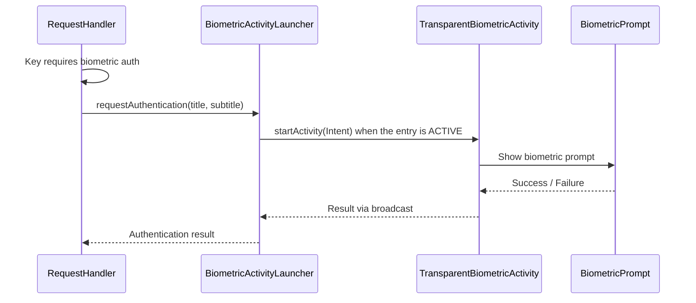

# User verification architecture

> Status: reference. Last checked against main on 2026-11-23.
> This page describes how xKey raises the biometric prompt from a background
> service, how prompts share the one screen, and how the session time window
> is measured.

## Overview

A request that reaches a key needing user authentication can arrive while no
xKey screen is open. The service then starts a transparent activity that shows
`BiometricPrompt`, and every prompt in the app waits its turn in one queue.
The `local.verifyUser` RPC and its user verification key are covered in
[FIDO2 built-in UV](../fido2-built-in-uv/architecture.md).

## Inter-process communication

### XKeyGattService to TransparentBiometricActivity

When the BLE service needs biometric authentication and no activity is in the
foreground, it uses `BiometricActivityLauncher` to start a transparent overlay
activity:

### The one prompt queue

There is one screen, so `PromptOwnership.process` holds one queue entry per
approval and lets one be ACTIVE at a time; the rest wait QUEUED in arrival
order. Every prompt in the app is raised from an ACTIVE entry, and
`PromptEntryPointsTest` fails on any raiser that is not listed below.

| Entry point | Queue key | How it waits for its turn |
|---|---|---|
| `BiometricActivityLauncher` (generic, crypto) | `approval-<id>`, `signature-<id>` | starts its activity from the entry's `onActive` |
| `TransparentBiometricActivity` | the intent's id | shows a prompt only while `accept` finds that key ACTIVE |
| `CryptoSigningActivity` | `signature-<id>` | `CryptoSigningController.attach` prompts only for the ACTIVE entry |
| `BiometricHelper.authenticate*` | `wake-biometric-<n>` | runs inside `PromptOwnership.turn`; `onTurn` posts the wake notification |
| `local.verifyUser` injected prompt | `wake-verifyUser-<n>` | runs inside `PromptOwnership.turn` with its wake notification |
| `CredentialSelectorActivity` | `wake-credentialSelector-<n>` | `enqueue`s and prompts from `onActive`; ends the entry on answer or destroy |
| `BiometricNotificationHelper.showBiometricRequiredNotification` | the caller's key | refuses (throws) any key that is not ACTIVE |
| `CredentialPendingIntentHelper` | none | pending intents for the system Credential Manager; the activity they open waits its turn |

A turn that has not come within the queue deadline (120 s) settles expired
and raises nothing; the caller gets `BiometricPrompt.ERROR_TIMEOUT`. The value
is `PendingAuthentications.QUEUE_DEADLINE_MILLIS` in
`auth/BiometricActivityLauncher.kt`. A launched request whose prompt has not
come up within `ACTIVE_DEADLINE_MILLIS` (60 s) also settles with a timeout.
That is longer than the 30 s lock-screen notification and shorter than the
queue deadline.

## The time window and its clock

In the `TIME_WINDOW` auth mode, `SessionAuthManager` skips the prompt until
the window chosen in Settings (`timeWindowSeconds`) has passed since the last
successful authentication. It measures the window on
`SystemClock.elapsedRealtime()`: milliseconds since boot, monotonic, and not
moved when the user or the network sets the wall clock. The window is
half-open: the prompt returns once `timeWindowSeconds` have passed. Before the
first authentication, and after `invalidateAuth`, there is no recorded reading
and the prompt is owed, even just after boot. A reading below the recorded one
counts as expired. The window is in memory only; `clearSession` (a BLE
disconnect) keeps it.
