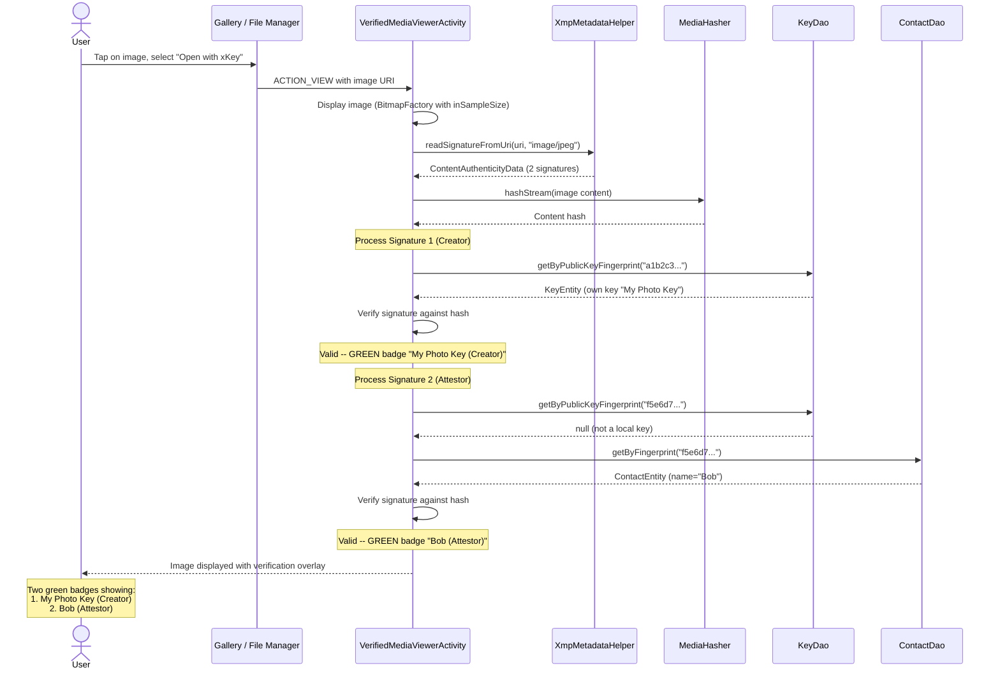

# Verified media viewer architecture

> **Status: REFERENCE** · Last verified: 2026-10-09
> As-built description of the verified media viewing flow in xKey.

## View Verified Media

A user opens a signed image to verify its authenticity and see who signed it.

## When a signer shows as verified

`SignerVerification.verify` (in `media/`) decides each signer's badge; the
file-operation screen's Verify uses the same function.

1. The stored content hash must match the file
   (`MediaHasher.contentHashMatchesUri`). If it does not, every signer
   fails: the signatures cover some other content.
2. The signer is looked up as a contact, then as a local key whose public
   key hashes to the entry's fingerprint. The signature is then checked
   against that public key (`SignatureVerifier.verifyEntry`): valid is
   verified (green), invalid is failed (red).
3. A signer with no public key we hold is unknown, never verified. A local
   key row without public key material never matches, even when its keyId
   equals the fingerprint: the fingerprint comes from the file being
   checked, so matching on it would let any file name a trusted signer.

## Where the badge name comes from

The name beside a badge comes from the key the signature was checked
against, never from the file (`SignerVerification.Result.displayName`):

| Case | Badge name | Claim line |
|---|---|---|
| Verified or failed, contact matched | contact name | embedded name, if it differs |
| Verified or failed, local key matched | local key label | embedded name, if it differs |
| Unknown, or failed with no match | embedded name, else the first 16 fingerprint characters | none |

A file signed by contact "Bob" that embeds signerName "Alice" shows a green
badge for "Bob" and, under it, "Claims: Alice"
(`Result.claimedName`, string `verified_viewer_claims`). The
file-operation screen's Verify shows `displayName` only.
