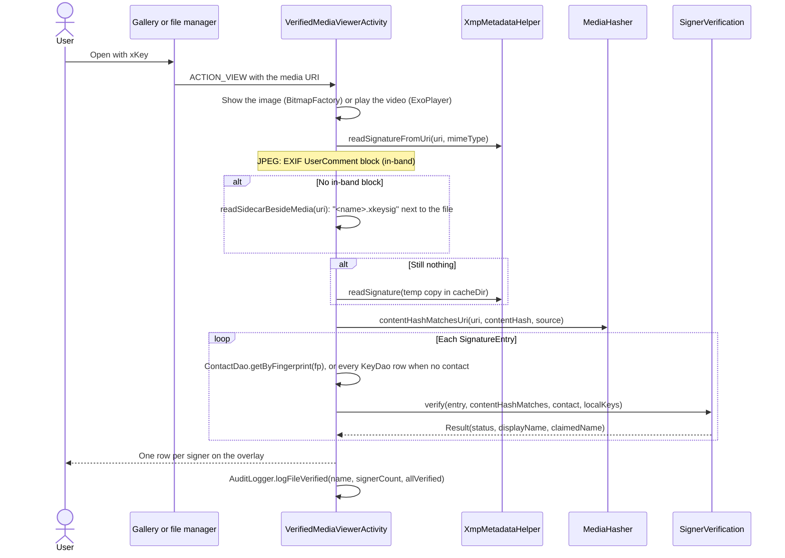

# Verified media viewer architecture

> **Status: REFERENCE** · Last verified: 2026-11-23
> How `VerifiedMediaViewerActivity` finds a file's signatures, checks each signer, and shows the result over the image or video.

The viewer is `ui/VerifiedMediaViewerActivity.kt`. Gallery and file manager
apps reach it through `ACTION_VIEW` for `image/*` and `video/*`. No screen
inside xKey opens it.

## Viewing a signed file

## Finding the signature block

The viewer tries three places in order and stops at the first block it
finds:

1. **In-band.** For a JPEG, `XmpMetadataHelper.readSignatureFromUri` reads
   the EXIF `UserComment` from the stream and accepts it when it starts with
   `XKEY_SIG:`.
2. **Sidecar beside the file.** `readSidecarBesideMedia` opens
   `<name>.xkeysig` next to the media. It can do this only for a `file://`
   URI, or for a document URI whose provider gives the sibling an ID made by
   adding `.xkeysig`. For any other URI, such as a `content://media/` URI from
   a gallery, it finds nothing.
3. **Temp copy.** The viewer copies the file to `cacheDir/verify_temp.<ext>`
   and calls `readSignature` on it, then deletes the copy. This reads the
   EXIF block of a JPEG by path. It cannot find a real sidecar, because it
   looks next to the temp copy.

With no block, or a block with no signatures, the overlay shows "No
signatures found in this file". An exception anywhere in the check shows the
same text.

## When a signer shows as verified

`SignerVerification.verify` (in `media/`) decides each row. Verify in
[file operations](../file-operations/architecture.md) uses the same function.

1. The stored content hash must match the file
   (`MediaHasher.contentHashMatchesUri`). An in-band block must match the
   canonical hash. A sidecar found beside the file may match the canonical
   hash or the whole-file hash. If neither matches, every signer fails: the
   signatures cover other content.
2. The public key comes from the contact whose fingerprint equals the
   entry's `keyFingerprint`. With no such contact, it comes from the local key
   whose public key DER hashes to that fingerprint. The signature is then
   checked against it (`SignatureVerifier`): valid is verified, invalid is
   failed.
3. A signer with no public key the phone holds is unknown, never verified. A
   local key row without public key material never matches, even when its
   key ID equals the fingerprint, because the fingerprint comes from the file
   being checked.

An exception while checking one entry marks that entry failed.

## Where the row name comes from

The name on a row comes from the key the signature was checked against, not
from the file (`SignerVerification.Result.displayName`):

| Case | Row name | Claim line |
|---|---|---|
| Verified or failed, contact matched | Contact name | Embedded name, if it differs |
| Verified or failed, local key matched | Local key label | Embedded name, if it differs |
| Unknown, or failed with no match | Embedded name, else the first 16 fingerprint characters | None |

A file signed by contact "Bob" that embeds signerName "Alice" shows a
verified row for "Bob" with "Claims: Alice" under it
(`Result.claimedName`, string `verified_viewer_claims`). Verify in file
operations shows `displayName` only.
