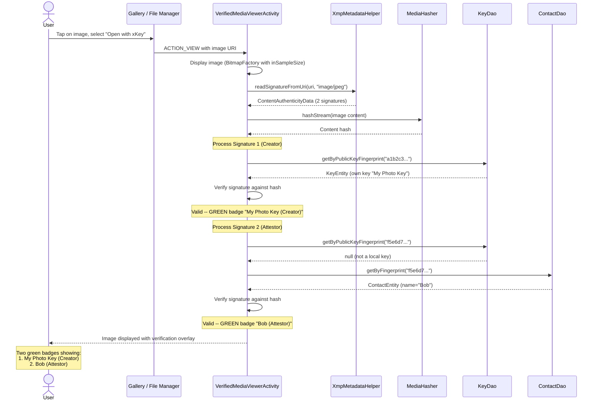

# Verified media viewer architecture

> **Status: REFERENCE** · Last verified: 2026-10-09
> As-built description of the verified media viewing flow in xKey.

## View Verified Media

A user opens a signed image to verify its authenticity and see who signed it.

